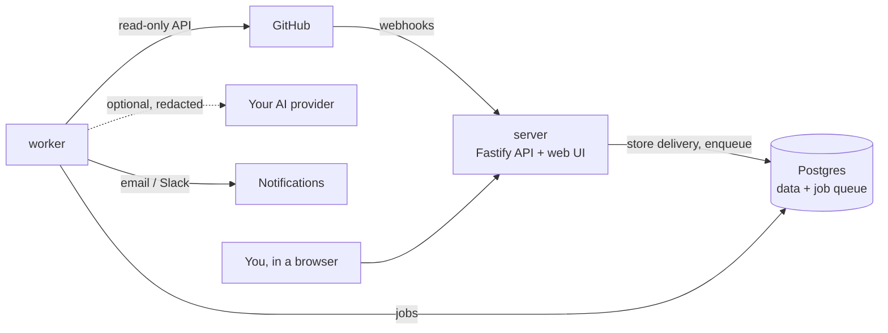

<div align="center">

# 🛫 git-merge-pilot

### Know what every pull request really changes before you merge it.

**Self-hosted, read-only PR intelligence for project managers, tech leads and the people who sign off on releases.**

[](https://github.com/arvind-007/git-merge-pilot/actions/workflows/ci.yml)
[](LICENSE)


[**Quickstart**](#-quickstart-5-minutes) · [**Features**](#-features) · [**How it works**](#%EF%B8%8F-how-it-works) · [**Docs**](#-documentation) · [**FAQ**](#-faq)

</div>

---

## 🤔 Why git-merge-pilot?

Pull requests are written for reviewers who read code. The people who decide **when** and **whether** to ship usually don't read diffs. They still have to answer questions like these:

- _"Will this PR break the mobile app that calls this API?"_
- _"Are two teams changing the same database table this sprint?"_
- _"Is this ready to merge, or is it waiting on something?"_
- _"What exactly is risky about this change?"_

**git-merge-pilot answers those questions for every PR, automatically.** It watches the repositories you choose and writes a plain-language, evidence-backed report as soon as a PR is opened or updated. Every claim links back to the file and line on GitHub that supports it.

<table>
<tr>
<td width="33%" valign="top">

### 🔒 Read-only by design

It never comments, approves, labels or merges. The GitHub App you create asks for **read** permissions only.

</td>
<td width="33%" valign="top">

### 🏠 Your servers, your data

It runs with one `docker compose up` on your own machine or VPS. Postgres is the only dependency.

</td>
<td width="33%" valign="top">

### 🧠 AI is optional

It is useful with AI switched off. If you opt in, use your own Anthropic or OpenAI-compatible key, choose a data mode for each repo, and set a budget cap.

</td>
</tr>
</table>

---

## ✨ Features

### 📝 A report on every PR, in plain language

| Section                         | What you get                                                                                 |
| ------------------------------- | -------------------------------------------------------------------------------------------- |
| **Executive summary**           | What the PR does and why it matters, in two or three sentences                               |
| **Business & technical impact** | Affected modules, services, APIs, database tables, integrations and config                   |
| **Breaking changes**            | Removed or renamed exports, changed signatures, dropped routes and columns, removed env vars |
| **Security**                    | Leaked secrets, risky patterns, auth changes, and GitHub code-scanning and Dependabot alerts |
| **Testing & deployment**        | Tests added or missing, CI status, migrations, ordering, rollback difficulty                 |
| **Merge readiness**             | One of five recommendations, with explicit blockers and a rationale                          |

Every statement is labelled **✅ Verified** (from deterministic analysis or GitHub data) or **⚠️ Potential concern** (an AI inference). git-merge-pilot never calls a PR "secure". It tells you what it checked and what it found.

### 🎯 Risk scored across six dimensions

```
Security          ██░░░░░░░░  20   low
Breaking change   ███████░░░  70   high
Integration       ████░░░░░░  40   medium
Regression        ███░░░░░░░  35   medium
Database          ██████████  90   critical
Deployment        ██░░░░░░░░  15   low
```

Each score comes with its rationale and the evidence behind it.

### 🔀 Cross-PR and cross-repo intelligence

- Finds **overlapping work**: PRs touching the same files, symbols, tables or config.
- Matches **API contracts across repositories**: HTTP routes, GraphQL, protobuf, events, queue topics and env vars. When a backend PR changes something a frontend repo consumes, you'll know.
- Flags **possible duplicate work** with AI assistance, always marked as "possible".

### ⚡ Incremental re-analysis

When a new commit is pushed, only the change is re-analysed. Each finding is tracked as **new**, **unchanged** or **resolved**, so you can see whether the latest push fixed the problem.

### 📊 Dashboards and projects

- Group any repositories into **projects** and add members. Members see only their projects.
- Overview, per-project and per-repository views, a **risk center**, a developers view and a system status page.

### 🔔 Notifications that respect your time

- In-app, **email** (SMTP) and **Slack**.
- Severity thresholds, quiet hours, deduplication and a **daily digest**.

### 🛡️ Security analysis

- Built-in secret detection and risky-pattern rules always run.
- [gitleaks](https://github.com/gitleaks/gitleaks) and [semgrep](https://semgrep.dev) are bundled in the Docker image.
- GitHub code-scanning, Dependabot and secret-scanning alerts are read when they are available.

---

## 🛡️ Built to be trusted

| Promise                                 | How it's kept                                                                                                                               |
| --------------------------------------- | ------------------------------------------------------------------------------------------------------------------------------------------- |
| **Never writes to GitHub**              | The App manifest requests read-only permissions. There is no code path that comments, approves or merges.                                   |
| **No code leaves without your consent** | AI is **off by default**. An admin must opt in, and that consent is recorded. Each repo can be `full`, `metadata_only` or `off`.            |
| **Secrets stay secret**                 | Secrets are redacted before any AI call. `exclude_paths` are never sent. Prompt-injection defences wrap all PR content.                     |
| **Credentials are encrypted**           | GitHub App keys, AI keys, and SMTP and Slack secrets are encrypted with AES-256-GCM under your `MASTER_KEY`. They are write-only in the UI. |
| **Costs are capped**                    | You set a monthly AI budget, with an alert at 80%. At 100%, reports fall back to deterministic analysis.                                    |

---

## 🚀 Quickstart (5 minutes)

### Prerequisites

| You need                         | Notes                                                                  |
| -------------------------------- | ---------------------------------------------------------------------- |
| **Docker** with Compose v2       | Engine 24 or later                                                     |
| **Node.js 22**                   | Only to generate secrets. You can also create them by hand             |
| **A GitHub account or org**      | Where the GitHub App will be created (you must be an owner for an org) |
| **1 GB RAM** (2 GB+ recommended) | semgrep and repository indexing use the most memory                    |

### 1️⃣ Clone and configure

```bash
git clone https://github.com/arvind-007/git-merge-pilot.git
cd git-merge-pilot

# Creates .env with a fresh MASTER_KEY and SESSION_SECRET (never overwrites an existing .env)
node scripts/init-env.mjs
```

> 💻 **Running on your laptop?** GitHub can't reach `localhost`. Open <https://smee.io/new>, copy the channel URL, and add it to `.env`:
>
> ```bash
> SMEE_URL=https://smee.io/your-channel-id
> ```
>
> The server has a built-in smee relay, so nothing else needs to run. Do this **before** you create the GitHub App.

### 2️⃣ Start the stack

```bash
docker compose up -d --build
```

This starts Postgres, runs the database migrations, and then starts the **server** (API and web UI on port 3000) and the **worker** (background jobs).

> 🔐 Binding to localhost only? Run `GMP_BIND=127.0.0.1 docker compose up -d --build`.

### 3️⃣ Open your one-time setup link

```bash
docker compose logs server | grep -o 'http[^ ]*/setup?token=[^ ]*'
```

Open the link. The setup token is built into it and stops working once your admin account exists.

### 4️⃣ Follow the setup wizard

| Step | What happens                                                                                                  |
| :--: | ------------------------------------------------------------------------------------------------------------- |
|  1   | **Create your admin account**: name, email and password. Your time zone is detected automatically.            |
|  2   | **Connect GitHub**: click _Create GitHub App_, confirm on GitHub, then install it on the repos you want.      |
|  3   | **Pick repositories** and create your first project.                                                          |
|  4   | **Enable AI (optional)**: review exactly what would be sent, add a provider, then choose models and a budget. |
|  5   | **Set up notifications**: email, Slack and rules.                                                             |
|  6   | **Review repository profiles**: the detected languages, frameworks, CI and docs.                              |
|  7   | **Start monitoring.** Open PRs are imported and analysed right away.                                          |

🎉 **That's it.** Open or update a PR in a monitored repository, and its report appears within a minute or two.

> ⚠️ **Back up your `MASTER_KEY` today.** It encrypts every stored credential. If you lose it, you'll have to reconnect GitHub and re-enter all your secrets. See [Backup & recovery](docs/backup-recovery.md).

### Upgrading

```bash
git pull
docker compose up -d --build   # migrations run automatically before the app starts
```

---

## ⚙️ How it works



1. **GitHub sends an event.** A PR is opened, a commit is pushed, a check finishes or a review lands. The server verifies the webhook signature and queues a job.
2. **The worker takes a snapshot** of the PR: its files, commits, checks, reviews and security alerts.
3. **Deterministic analysis runs first.** Diffs are parsed with tree-sitter into symbols and contracts. Then the breaking-change, security and overlap detectors run, and risk is scored.
4. **AI writes the narrative** (only if you opted in). It works from redacted evidence. Without AI, the report is built from the deterministic results and labelled as such.
5. **You get the report and alerts**, and new commits trigger an incremental update.

A 15-minute reconciliation poll catches anything a webhook missed.

---

## 🧰 Tech stack

<table>
<tr><td><b>Backend</b></td><td>TypeScript · Node 22 · Fastify 5 · Drizzle ORM · pg-boss</td></tr>
<tr><td><b>Frontend</b></td><td>React 18 · Vite · TanStack Query · Tailwind CSS v4</td></tr>
<tr><td><b>Analysis</b></td><td>web-tree-sitter (TS/JS, Python, Go, Java) · gitleaks · semgrep</td></tr>
<tr><td><b>AI</b></td><td>Anthropic · any OpenAI-compatible API (OpenAI, Azure, OpenRouter, LiteLLM, Ollama, vLLM)</td></tr>
<tr><td><b>Infra</b></td><td>Postgres 16 (also the job queue, so there's no Redis) · Docker Compose</td></tr>
</table>

<details>
<summary><b>Monorepo layout</b></summary>

| Package             | Responsibility                                                                                  |
| ------------------- | ----------------------------------------------------------------------------------------------- |
| `packages/core`     | config, logger with redaction, crypto, secret redaction, shared schemas                         |
| `packages/db`       | Drizzle schema, SQL migrations, client                                                          |
| `packages/github`   | GitHub App manifest, webhooks, discovery, PR snapshots                                          |
| `packages/analysis` | deterministic analysis: diffs, symbols, contracts, breaking changes, security, overlap, scoring |
| `packages/ai`       | providers, prompts, report generation, budget and usage                                         |
| `packages/notify`   | channels, dispatcher, digest                                                                    |
| `apps/server`       | REST API, auth, setup, webhook endpoint, serves the web UI                                      |
| `apps/worker`       | background jobs                                                                                 |
| `apps/web`          | React single-page app                                                                           |

</details>

---

## 👩‍💻 Development

```bash
pnpm install
pnpm init-env                                   # .env pointing at the dev database
docker compose -f docker-compose.dev.yml up -d  # Postgres on localhost:54329
pnpm db:migrate
pnpm dev                                        # server :3000 · worker · web (Vite) :5173
```

Open <http://localhost:5173/setup>.

| Command                                | What it does                                          |
| -------------------------------------- | ----------------------------------------------------- |
| `pnpm test`                            | all tests (database tests need the dev Postgres)      |
| `pnpm typecheck`                       | TypeScript across every package                       |
| `pnpm lint` · `pnpm format:check`      | ESLint and Prettier                                   |
| `pnpm build`                           | web UI, server, worker and migration CLI bundles      |
| `pnpm db:generate` · `pnpm db:migrate` | create a migration from the schema · apply migrations |

---

## 📚 Documentation

| Guide                                        | For                                                             |
| -------------------------------------------- | --------------------------------------------------------------- |
| [Installation](docs/installation.md)         | Docker or from source, the image, upgrading                     |
| [Setup guide](docs/setup-guide.md)           | A walkthrough of the first-time wizard                          |
| [GitHub App](docs/github-app.md)             | Permissions, smee, reauthorizing or disconnecting, GHES         |
| [AI providers](docs/ai-providers.md)         | Anthropic, OpenAI-compatible, local models, budgets, data modes |
| [User guide](docs/user-guide.md)             | Reading reports, risk and recommendations                       |
| [Configuration](docs/configuration.md)       | Every environment variable                                      |
| [Deployment](docs/deployment.md)             | VPS, TLS with Caddy, Fly.io and Railway, scaling                |
| [Backup & recovery](docs/backup-recovery.md) | `pg_dump`, restoring, `MASTER_KEY`                              |
| [Architecture](docs/architecture.md)         | Components, event flow, jobs, incremental and cross-PR analysis |
| [Security](docs/security.md)                 | Threat model, encryption, data flow, retention                  |
| [API](docs/api.md)                           | REST endpoints                                                  |
| [Troubleshooting](docs/troubleshooting.md)   | Common problems and fixes                                       |

---

## ❓ FAQ

<details>
<summary><b>Does git-merge-pilot ever change anything on GitHub?</b></summary>

No. The GitHub App only requests read permissions, and the code has no write paths. It never comments, reviews, approves, labels or merges.

</details>

<details>
<summary><b>Do I need an AI provider?</b></summary>

No. Without AI, you still get breaking-change detection, security findings, overlap detection, risk scores and merge readiness. Reports are clearly marked "Generated without AI". AI adds the plain-language narrative.

</details>

<details>
<summary><b>What exactly is sent to the AI provider?</b></summary>

It depends on each repository's data mode. With `full`, it sends PR text and redacted diffs. With `metadata_only`, it sends PR text, paths and symbol names, but no code. With `off`, nothing is sent. Secrets are always redacted, and `exclude_paths` are never sent. The setup wizard shows you the data flow before you enable anything.

</details>

<details>
<summary><b>Can I run it on my laptop?</b></summary>

Yes. Set `SMEE_URL` to a free [smee.io](https://smee.io/new) channel, and webhooks are relayed to your machine through the server's built-in client.

</details>

<details>
<summary><b>Which languages are analysed?</b></summary>

Symbol-level analysis covers TypeScript/JavaScript, Python, Go and Java. Other languages fall back to pattern-based analysis. Security scanning with gitleaks and semgrep is language-agnostic.

</details>

<details>
<summary><b>Does it work with GitHub Enterprise Server?</b></summary>

The API base URLs are configurable, but GHES is untested so far. Feedback is welcome.

</details>

---

## 🚧 Known limitations

- Symbol-level analysis covers TS/JS, Python, Go and Java only.
- Cross-repo consumer detection relies on literal route, topic and env var names.
- Duplicate-work detection is AI-assisted and is always marked "possible".
- Branch protection is inferred from `mergeable_state` and `reviewDecision`, because no admin permission is requested.
- There is one organization per install. The schema is ready for more.

---

## 🤝 Contributing

Issues, ideas and pull requests are welcome. Start with [CONTRIBUTING.md](CONTRIBUTING.md). Please report security issues privately, as described in [SECURITY.md](SECURITY.md).

If git-merge-pilot saves you time, consider giving it a ⭐. It helps others find it.

## 📄 License

[Apache License 2.0](LICENSE). See also [NOTICE](NOTICE).
