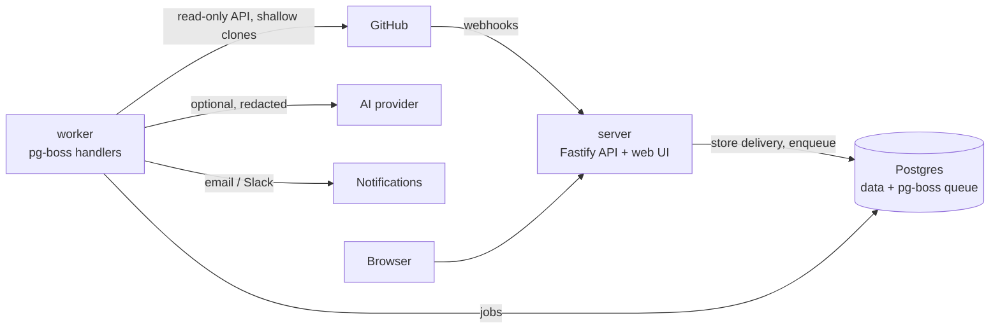

# git-merge-pilot

[](https://github.com/arvind-007/git-merge-pilot/actions/workflows/ci.yml)
[](LICENSE)


**Self-hosted, read-only GitHub pull request intelligence for project managers.**

git-merge-pilot watches the repositories you choose and writes a plain-language, evidence-backed report for every pull request. Each report covers what the PR does, its business impact, breaking changes, security concerns, overlap with other PRs (across repositories too), merge readiness and risk. It connects through a GitHub App you create in one click, and that App is **read-only**: git-merge-pilot never comments, approves, merges or writes to GitHub in any way.

Reports start with plain language. Technical evidence follows, with file and line links into GitHub. Every statement is labelled either **Verified** (from deterministic analysis or GitHub data) or **Potential concern** (AI inference). git-merge-pilot never claims that a PR is "secure".

Licensed under [Apache-2.0](LICENSE).

## Contents

- [How it works](#how-it-works)
- [Features](#features)
- [What it never does](#what-it-never-does)
- [Requirements](#requirements)
- [5-minute quickstart (Docker)](#5-minute-quickstart-docker)
- [Developing locally](#developing-locally-without-the-docker-image)
- [Architecture overview](#architecture-overview)
- [Documentation](#documentation)
- [Known limitations](#known-limitations)
- [Contributing](#contributing)

## How it works

1. **GitHub sends an event.** A PR is opened, a commit is pushed, a check finishes or a review lands. The server verifies the webhook signature, stores the delivery and queues a job.
2. **The worker takes a snapshot.** Through the read-only GitHub App it reads the PR, its files, commits, checks, reviews and (when available) security alerts.
3. **Deterministic analysis runs first.** Diffs are parsed with tree-sitter into symbols and contracts. Breaking-change, security (built-in rules, gitleaks, semgrep) and overlap detectors run, and six risk dimensions are scored.
4. **AI writes the narrative (optional).** If an admin has opted in, redacted evidence goes to your chosen model, which writes the plain-language report. Without AI, the report is built from the deterministic results and labelled as such.
5. **You get the report and alerts.** The report appears in the dashboard, and notifications go out in-app, by email or to Slack according to your rules. New commits trigger an incremental re-analysis.

## Features

- **Easy first-time setup.** A guided wizard covers the admin account, GitHub App creation via the manifest flow, repository selection, AI provider, notifications and monitoring.
- **Dynamic projects.** Group any repositories into projects and add project members. Members only see the projects they belong to.
- **Multi-repo monitoring.** Webhooks keep repositories current, with a [smee.io](https://smee.io) relay for local installs and a reconciliation poll every 15 minutes as a safety net.
- **PR reports.** Each report covers:
  - executive summary, business impact and technical summary
  - affected areas
  - testing and deployment notes
  - rollback difficulty
  - recommended actions
- **Breaking-change detection.** Flags removed or renamed exports, signature changes, removed routes and method changes, schema drops and renames, new NOT NULL columns, env var removals, event and proto field changes, and auth middleware changes.
- **Security analysis.** Built-in secret and risky-pattern rules always run. [gitleaks](https://github.com/gitleaks/gitleaks) and [semgrep](https://semgrep.dev) run when present (both ship in the Docker image). GitHub code-scanning, Dependabot and secret-scanning alerts are read when the App has the permission.
- **Cross-PR intelligence.** Detects overlap on files, symbols, database tables and config. Contract changes are matched across repositories (HTTP routes, GraphQL, proto, events, env vars, queue topics), along with explicit dependencies. Duplicate work is flagged as AI-assisted and "possible".
- **Merge readiness and risk.** Scores six risk dimensions from 0 to 100, gives an overall risk level and one of five recommendations, each with explicit blockers and a rationale.
- **Incremental analysis.** When new commits arrive, only the change is re-analysed. Each finding is tracked as new, unchanged or resolved.
- **Dashboard.** Global overview, per-project and per-repository views, a risk center, a developers view and a system status page.
- **Notifications.** In-app, email (SMTP) and Slack. Includes severity thresholds, quiet hours, deduplication and a daily digest.
- **Bring your own AI, or none.**
  - Supports Anthropic and any OpenAI-compatible endpoint: OpenAI, Azure, OpenRouter, LiteLLM, Ollama and vLLM.
  - AI is **off until an admin explicitly opts in**.
  - You can choose the model for each task and set a monthly budget cap.
  - Each repository has its own data mode: `full`, `metadata_only` or `off`.
- **Encrypted credentials.** GitHub App keys, AI keys, SMTP and Slack secrets are stored with AES-256-GCM under your `MASTER_KEY`.

## What it never does

- It never writes to GitHub: no comments, reviews, approvals, labels, status checks or merges.
- It never sends code to an AI provider unless an admin has explicitly enabled AI, and then only according to each repository's data mode. Secrets are redacted and `exclude_paths` are removed first.
- It never claims a pull request is "secure". It reports what it checked and what it found.
- It never stores credentials in plain text or shows them again after they are saved.

## Requirements

| Component | Version                                                                 |
| --------- | ----------------------------------------------------------------------- |
| Docker    | Engine 24+ with Compose v2                                              |
| Node.js   | 22.x (only to generate secrets, or for local development)               |
| pnpm      | the version pinned in `package.json` (local development only)           |
| GitHub    | a personal account or an organization you own, to create the GitHub App |
| Memory    | 1 GB minimum, 2 GB+ recommended                                         |

## 5-minute quickstart (Docker)

You can generate the secrets without Node too; see [docs/configuration.md](docs/configuration.md).

```bash
git clone https://github.com/arvind-007/git-merge-pilot.git
cd git-merge-pilot

# 1. Create .env with a fresh MASTER_KEY and SESSION_SECRET (never overwrites an existing .env)
node scripts/init-env.mjs

# 2. Start postgres, run migrations, start server + worker
docker compose up -d --build

# 3. Open the one-time setup link printed by the server (it includes the setup token)
docker compose logs server | grep -o 'http[^ ]*/setup?token=[^ ]*'
```

The wizard walks you through these steps. See [docs/setup-guide.md](docs/setup-guide.md) for details.

1. Create the admin account: your name, email and password (time zone is detected).
2. Connect GitHub. Click **Create GitHub App**, confirm on GitHub, then install the App on the repositories you want.
3. Select repositories and create your first project.
4. Optionally enable AI. Review the data-flow screen, add a provider, then pick models and a budget.
5. Configure notifications.
6. Review the discovered repository profiles.
7. Start monitoring.

> **Running on your laptop?** GitHub cannot reach `localhost`. Create a channel at <https://smee.io/new>, put it in `.env` as `SMEE_URL=...`, and run `docker compose up -d` again _before_ creating the GitHub App. The server has a built-in smee client, so nothing else needs to run. See [docs/github-app.md](docs/github-app.md#local-development-webhooks-via-smee).

> **Back up `MASTER_KEY`.** It encrypts every stored credential. If you lose it, you have to re-create the GitHub App connection and re-enter all AI, SMTP and Slack secrets. See [docs/backup-recovery.md](docs/backup-recovery.md).

### Developing locally (without the Docker image)

```bash
pnpm install
pnpm init-env                                   # creates .env pointing at the dev database
docker compose -f docker-compose.dev.yml up -d  # postgres on localhost:54329
pnpm db:migrate
pnpm dev                                        # server :3000, worker, web (Vite) :5173
```

Open `http://localhost:5173/setup`. Useful scripts:

| Command                                | What it does                                          |
| -------------------------------------- | ----------------------------------------------------- |
| `pnpm test`                            | all tests (database tests need the dev Postgres up)   |
| `pnpm typecheck`                       | TypeScript across every package                       |
| `pnpm lint` / `pnpm format:check`      | ESLint and Prettier                                   |
| `pnpm build`                           | web SPA, server, worker and migration CLI bundles     |
| `pnpm db:generate` / `pnpm db:migrate` | create a migration from the schema / apply migrations |

## Architecture overview



It is a TypeScript (Node 22, ESM) pnpm monorepo:

| Package                               | Responsibility                                                                                  |
| ------------------------------------- | ----------------------------------------------------------------------------------------------- |
| `packages/core` (`@gmp/core`)         | config, logger with redaction, crypto, secret redaction, enums, zod schemas                     |
| `packages/db` (`@gmp/db`)             | Drizzle schema, SQL migrations, client                                                          |
| `packages/github` (`@gmp/github`)     | GitHub App manifest, webhooks, discovery, PR snapshots                                          |
| `packages/analysis` (`@gmp/analysis`) | deterministic analysis: diffs, symbols, contracts, breaking changes, security, overlap, scoring |
| `packages/ai` (`@gmp/ai`)             | providers, prompts, report generation, budget and usage                                         |
| `packages/notify` (`@gmp/notify`)     | channels, dispatcher, digest                                                                    |
| `apps/server` (`@gmp/server`)         | REST API, auth, setup, webhook endpoint, serves the SPA                                         |
| `apps/worker` (`@gmp/worker`)         | background jobs                                                                                 |
| `apps/web` (`@gmp/web`)               | React SPA                                                                                       |

The only infrastructure is Postgres, which also holds the job queue via pg-boss. There is no Redis. See [docs/architecture.md](docs/architecture.md).

## Documentation

| Guide                                                            | For                                                             |
| ---------------------------------------------------------------- | --------------------------------------------------------------- |
| [Installation](docs/installation.md)                             | Installing with Docker or from source                           |
| [Setup guide](docs/setup-guide.md)                               | First-time wizard walkthrough                                   |
| [GitHub App](docs/github-app.md)                                 | Manifest flow, permissions, smee, reauthorize/disconnect, GHES  |
| [AI providers](docs/ai-providers.md)                             | Anthropic, OpenAI-compatible, local models, budgets, data modes |
| [User guide](docs/user-guide.md)                                 | Project managers: reading reports, risk, recommendations        |
| [Configuration](docs/configuration.md)                           | Environment variables                                           |
| [Deployment](docs/deployment.md)                                 | VPS, TLS with Caddy, Fly.io/Railway, scaling                    |
| [Backup & recovery](docs/backup-recovery.md)                     | `pg_dump`, restore, `MASTER_KEY`                                |
| [Architecture](docs/architecture.md)                             | Components, event flow, jobs, incremental and cross-PR analysis |
| [Security](docs/security.md)                                     | Threat model, encryption, data flow, retention                  |
| [API](docs/api.md)                                               | REST endpoints                                                  |
| [Troubleshooting](docs/troubleshooting.md)                       | Common problems                                                 |
| [Contributing](CONTRIBUTING.md) · [Security policy](SECURITY.md) |                                                                 |

## Known limitations

- Symbol-level analysis covers TS/JS, Python, Go and Java only. Other languages fall back to regex.
- Cross-repo consumer detection relies on literal route, topic and env var names.
- Semantic duplicate-work detection is AI-assisted and always marked "possible".
- Branch protection is inferred from `mergeable_state` and `reviewDecision`, because no admin permission is requested.
- GitHub Enterprise Server is untested. Only the base URLs are configurable.
- One organization per install. The schema is tenant-ready.

## Contributing

Issues and pull requests are welcome. Read [CONTRIBUTING.md](CONTRIBUTING.md) first, and report security problems privately as described in [SECURITY.md](SECURITY.md).

## License

Apache License 2.0. See [LICENSE](LICENSE) and [NOTICE](NOTICE).
