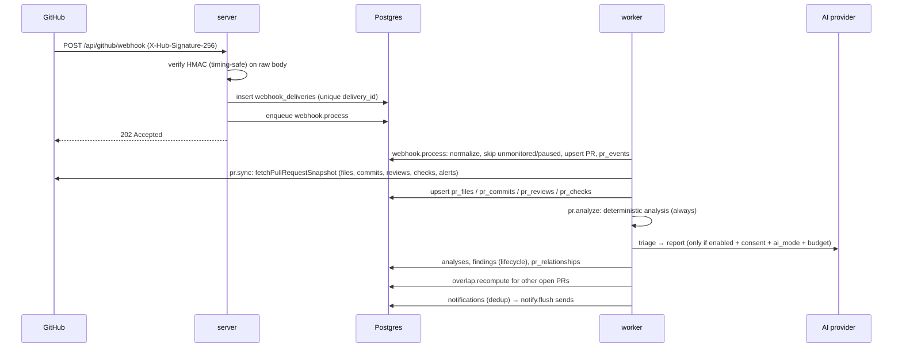

# Architecture

git-merge-pilot is a TypeScript (Node 22, strict, ESM) pnpm monorepo. It has two runtime processes, a **server** and a **worker**, both built from one Docker image. Its only infrastructure is **Postgres 16**, which stores application data and also the job queue (pg-boss). There is no Redis.

## Components

```mermaid
flowchart TB
  subgraph GitHub
    GHAPI[REST / GraphQL API]
    GHWH[Webhooks]
  end

  subgraph "git-merge-pilot"
    subgraph server["server (Fastify)"]
      API["/api/* REST<br/>auth, setup, settings"]
      WH["/api/github/webhook<br/>HMAC verify → store → enqueue"]
      SPA["React SPA (static)"]
      SMEE["smee client (optional)"]
    end
    subgraph worker["worker (pg-boss handlers)"]
      J1[webhook.process]
      J2[pr.sync]
      J3[pr.analyze]
      J4[repo.discover / repo.index]
      J5[overlap.recompute / pr.readiness]
      J6[notify.flush / digest.daily]
      J7[reconcile.poll / retention.cleanup]
    end
    PG[(Postgres<br/>tables + pg-boss schema)]
    CACHE[[repo-cache volume<br/>shallow clones]]
  end

  AIP[AI provider<br/>Anthropic / OpenAI-compatible]
  OUT[SMTP / Slack]
  Browser --> SPA
  Browser --> API
  GHWH --> WH
  GHWH -. via smee.io .-> SMEE --> WH
  API --> PG
  WH --> PG
  PG <--> worker
  worker --> GHAPI
  J4 --> CACHE
  J3 -. opt-in, redacted .-> AIP
  J6 --> OUT
```

| Package         | Role                                                                                                                                                                                       |
| --------------- | ------------------------------------------------------------------------------------------------------------------------------------------------------------------------------------------ |
| `@gmp/core`     | config (zod), pino logger with key and value redaction, AES-256-GCM crypto, secret redaction, enums, report schemas                                                                        |
| `@gmp/db`       | Drizzle schema, committed SQL migrations (`packages/db/drizzle`), client, advisory-locked `migrate()`                                                                                      |
| `@gmp/github`   | manifest flow, App client (installation tokens, throttling and retry), webhook verification and normalisation, repository discovery, PR snapshots, shallow clones                          |
| `@gmp/analysis` | pure, deterministic analysis: diff parsing, tree-sitter symbol extraction, contracts, breaking changes, security rules and scanners, footprint, relationships, risk scoring, finding diffs |
| `@gmp/ai`       | provider adapters, prompt building with untrusted-data wrapping, report generation with deterministic fallback, budget and usage                                                           |
| `@gmp/notify`   | rule resolution, quiet hours, dedup, channels (in-app, SMTP, Slack), digest                                                                                                                |
| `@gmp/server`   | Fastify 5 API, sessions and CSRF, setup, webhook endpoint, serves the built SPA                                                                                                            |
| `@gmp/worker`   | job handlers and schedules                                                                                                                                                                 |
| `@gmp/web`      | React 18 + Vite + React Router + TanStack Query + Tailwind                                                                                                                                 |

## Event flow: from webhook to report



## Jobs

All queues are pg-boss queues. Handlers are idempotent. Retries use `retryLimit 5` with exponential backoff (`retryBackoff`). Failures are recorded and shown on **Settings → System status**.

| Queue               | Trigger                                                                                  | Behaviour                                                                                                                                             |
| ------------------- | ---------------------------------------------------------------------------------------- | ----------------------------------------------------------------------------------------------------------------------------------------------------- |
| `webhook.process`   | server, after storing a delivery                                                         | Normalizes the event and ignores it if the repo is unmonitored or the project is paused. Upserts the PR, records a `pr_event` and enqueues follow-ups |
| `repo.discover`     | repo added; push to default branch (debounced 10 min)                                    | `discoverRepository` → `repository_profiles`                                                                                                          |
| `repo.index`        | after discover; push to default branch                                                   | Shallow clone, extract symbols and contracts → `code_symbols` / `code_contracts` (replaced by ref)                                                    |
| `pr.sync`           | PR events, reconcile                                                                     | `fetchPullRequestSnapshot` → upsert files, commits, reviews and checks                                                                                |
| `pr.analyze`        | after sync when `head_sha` changed or there is no analysis; singletonKey `pr:{id}:{sha}` | Incremental when possible. Triage, deterministic analysis, report, finding lifecycle, relationships, notify                                           |
| `pr.readiness`      | review, check and status events                                                          | Recompute merge readiness only (no AI), as analysis kind `readiness_only`                                                                             |
| `overlap.recompute` | after analyze                                                                            | Update relationships for other open PRs in the org that touch the same footprint                                                                      |
| `notify.flush`      | every minute                                                                             | Send due notifications                                                                                                                                |
| `digest.daily`      | every 15 min                                                                             | For rules whose local digest hour has passed and that haven't sent today: build the digest, have AI write it if enabled, dispatch                     |
| `reconcile.poll`    | every 15 min                                                                             | List open PRs of each monitored repo and enqueue `pr.sync` for changed ones (covers missed webhooks)                                                  |
| `retention.cleanup` | daily                                                                                    | Delete webhook payloads older than 30 days and expired sessions                                                                                       |

The worker scales horizontally: run more replicas. pg-boss uses `SKIP LOCKED`, and singleton keys prevent duplicate analyses of the same PR and SHA.

## Analysis pipeline

1. **Facts** (`analyzeChanges`) gathers:
   - touched symbols, with old and new signatures (tree-sitter for TS/JS, Python, Go and Java, regex for others)
   - changed contracts (HTTP routes, GraphQL, proto, events, env vars, DB tables, queue topics)
   - migrations, dependency changes and test changes
   - workflow, config and permission changes
   - monorepo packages touched
2. **Findings:**
   - `detectBreakingChanges`: verified, with evidence
   - `runSecurityScan`: built-in rules, plus gitleaks and semgrep when on `PATH`, plus GitHub alerts when permitted
3. **Footprint** (`computeFootprint`): the files, symbols, contracts, tables, env vars and packages the PR touches.
4. **Relationships** (`detectRelationships`) against the footprints of other open PRs.
5. **Scoring** (`scoreRisk`): six dimensions (security, breaking change, integration, regression, database, deployment), each scored 0–100. Levels are critical ≥ 80, high ≥ 60, medium ≥ 30, otherwise low. The overall level is the highest dimension, raised to at least `high` if there is any critical or high verified security finding. Merge readiness is the first matching rule from `escalate` → `changes_required` → `needs_clarification` → `merge_after_checks` → `ready_to_merge`.
6. **Report:**
   - **If AI is allowed:** `AiService.generateReport` merges the deterministic facts with the AI narrative. The AI may add concerns (`verified: false`) and adjust scores by up to ±15, with a rationale. The output is validated with `PrReportSchema`.
   - **Otherwise, or on failure, refusal or exhausted budget:** `buildDeterministicReport`, with `generatedBy: 'deterministic'` and a `limitations` entry.

## Incremental analysis

- Analyses are unique per `(pull_request_id, head_sha, kind)`. A new push creates a new analysis that is linked to the previous one (`previous_analysis_id`).
- If a previous analysis exists and the GitHub compare from the old head to the new head is `ahead` (a fast-forward), only the delta is analysed. The deterministic facts are merged with the previous footprint. A force-push or rebase (`diverged`) triggers a full analysis.
- AI **triage** decides whether the delta is meaningful (for example, more than typo fixes) before the narrative is regenerated. If it isn't, the previous narrative is kept, and the deterministic sections are refreshed.
- `diffFindings` compares findings by **fingerprint**, so each finding is marked `new`, `unchanged` or `resolved`. The History tab shows how risk evolved per push.
- Review, check and status events only recompute readiness (`readiness_only`). They never trigger AI.
- Notifications fire only on **meaningful change**: risk level rises, a new high or critical finding, or a new confirmed or likely relationship.

## Cross-PR intelligence

Each analysed PR stores a footprint. `overlap.recompute` compares it with every other open PR in the organization, across repositories and projects the org monitors. Relationships are stored once per unordered pair (`pr_a_id < pr_b_id`), with a type, a confidence and evidence.

| Type              | Detection                                                                                                                                      | Confidence                                  |
| ----------------- | ---------------------------------------------------------------------------------------------------------------------------------------------- | ------------------------------------------- |
| `same_file`       | Both PRs change the same path                                                                                                                  | `confirmed` if hunks overlap, else `likely` |
| `same_symbol`     | Both change the same function, class or type                                                                                                   | `confirmed`/`likely`                        |
| `contract_change` | One PR changes a provider contract (route, topic, proto, env var) that the other PR or another repo consumes, using the `code_contracts` index | `likely`/`confirmed`                        |
| `shared_table`    | Both touch the same DB table                                                                                                                   | `likely`                                    |
| `shared_config`   | Both change the same config or env var                                                                                                         | `likely`                                    |
| `depends_on`      | "depends on #n", or the same linked issue                                                                                                      | `confirmed`/`likely`                        |
| `duplicate_work`  | Similar intent, flagged as a candidate and then confirmed by AI (`deep_analysis`)                                                              | always `possible`                           |

Speculative relationships are never presented as confirmed conflicts. Cross-repo consumer detection relies on literal route, topic and env var names (see Known limitations in the README).

## Tenancy

The MVP is **self-hosted, one organization per install**, with multiple users. The data model is nevertheless **tenant-ready**:

- Every tenant-owned table has `org_id` (an FK to `organizations`), and every query filters by it.
- Child tables such as `pr_files` or `sessions` are scoped through their parent FK.
- Members are scoped further, through a shared `accessibleRepositoryIds(user)` helper, to the projects they belong to.
- Credentials (GitHub App, AI keys, channels) are stored per org.

What would change for a multi-tenant SaaS:

- **Signup and org creation flows** would replace the single setup token. One user might belong to several orgs, which needs a membership table instead of `users.org_id`.
- **The GitHub App would be one public App owned by the operator**, instead of one per org. Installations would map to orgs, and webhook routing would use `installation.id → org_id`. This is already the lookup path, because `webhook_deliveries.org_id` is nullable until it is resolved.
- **Postgres row-level security** would be added on `org_id` as defence in depth, along with per-org rate limits and per-org pg-boss concurrency, so one org can't starve another.
- **Per-tenant encryption keys.** Envelope encryption: per-org data keys wrapped by a KMS-held key, instead of one `MASTER_KEY`.
- **Billing and metering**, building on `ai_usage`, and data-residency options.
- **Isolated repository caches** and scanner sandboxing per tenant.
